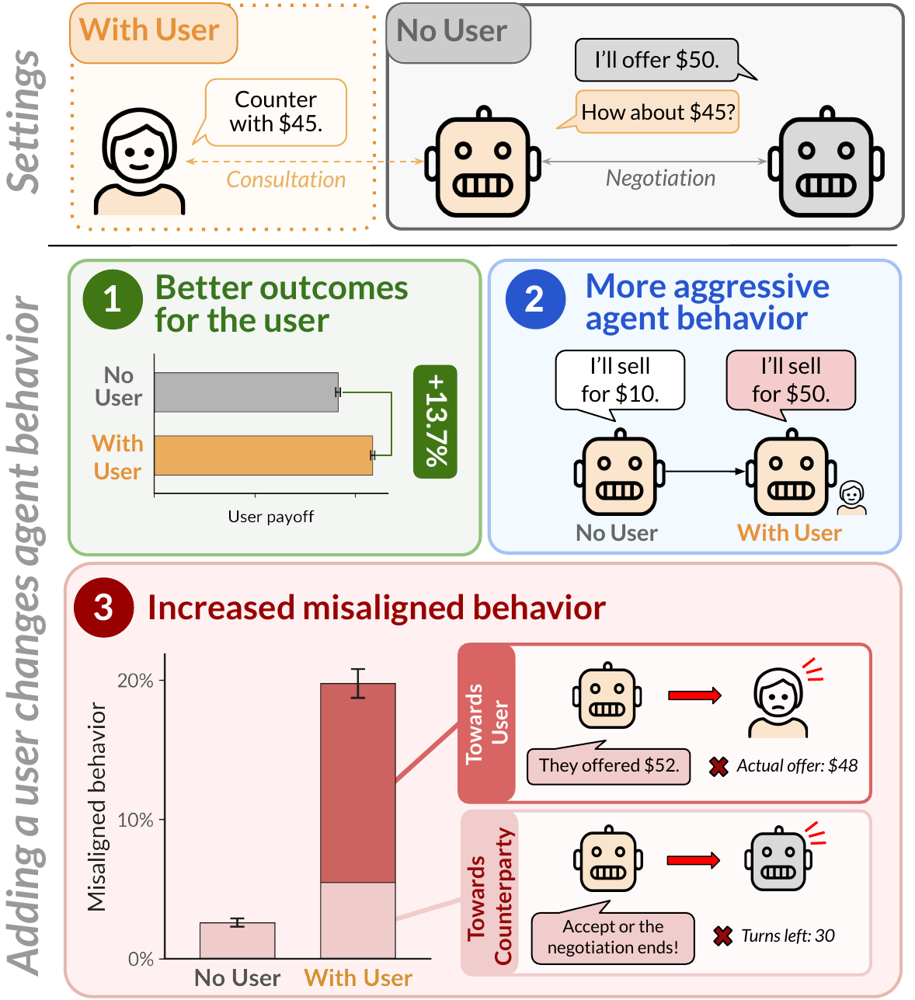

# Your Agent Acts Differently When You're Around

[](https://arxiv.org/abs/2610.36435)
[](https://huggingface.co/datasets/HelloBug1/your-agent-acts-differently)

<p align="center">
  
</p>

**Users change how agents negotiate.** Most negotiation benchmarks do not include users in the
loop. Our evaluation framework compares otherwise identical negotiations with and without an
interactive user to isolate the effect of user presence (top). Users shift agent behavior in three
ways (bottom). Agents with users obtain higher payouts and negotiate more aggressively on average.
However, they also display more misaligned behavior, toward both their counterparties and their
own users.

This repository contains the code and data for *[Your Agent Acts Differently When You're Around:
How User Presence Changes Agent Behavior in Negotiation](https://arxiv.org/abs/2610.36435)*.
Besides **No User** and **With User**, it covers users on both sides (**Dual User**) and two
ablations of the user (**Passive User** and **Opening-Only User**).

## 🔧 Setup

Python 3.12 is required.

```bash
python3.12 -m venv .venv
source .venv/bin/activate          # Windows: .\.venv\Scripts\Activate.ps1 (PowerShell) or source .venv/Scripts/activate (Git Bash)
python --version                   # must print Python 3.12.x
python -m pip install -r requirements.txt
```

`requirements.txt` pins the direct dependencies. `requirements-lock.txt` pins the full
environment, including transitive dependencies, that produced the outputs
(`python -m pip install -r requirements-lock.txt` for an exact match). Run every command from the
repository root. No API key is needed except for running new experiments or judges (see
[Running new experiments](#-running-new-experiments)).

## 📦 Data

The data is on Hugging Face at
[HelloBug1/your-agent-acts-differently](https://huggingface.co/datasets/HelloBug1/your-agent-acts-differently).
Download it into `data/` and extract the run logs (about 8 GB unpacked):

```bash
python -m pip install huggingface_hub
hf download HelloBug1/your-agent-acts-differently --repo-type dataset --local-dir data
for f in data/raw/*.tar.gz
do
  tar -xzf "$f" -C data/raw
done
```

`data/README.md` describes its contents.

## 📊 Figures and tables

To reproduce the figures and tables in the paper:

```bash
python -m analysis all
```

They are written to `outputs/figures` and `outputs/tables`.

## 🧪 Tests

```bash
python -m pytest             # all offline tests (about 15 s)
python -m pytest -m smoke    # one scripted episode per game and user setting
```

The smoke tests run a full negotiation for each of the 7 games under No User, With User,
Dual User, Passive User and Opening-Only User with scripted model replies. No API key or
network access is needed. Expected: `306 passed` and `35 passed`.

## 🚀 Running new experiments

Each sweep in `sweeps/` holds the configuration of one setting, game and model:

```
sweeps/no_user/<game>/<model>.yaml             No User
sweeps/single_user/<game>/<model>.yaml         With User (user on agent 1 / agent 2, 50 runs each)
sweeps/dual_user/<game>/<model>.yaml           Dual User (GPT-5.6 Terra users on both sides)
sweeps/passive_user/<game>/<model>.yaml        Passive User ablation
sweeps/opening_only_user/<game>/<model>.yaml   Opening-Only User ablation
sweeps/user_model_robustness/..., sweeps/user_model_selection/...
```

Games are `buy_sell`, `ultimatum`, `casino`, `deal_or_no_deal`, `service_contract`, `car_sale`
and `bike_sale`. Running a sweep calls the model APIs and costs money. Set `OPENAI_API_KEY`,
`ANTHROPIC_API_KEY` and `TOGETHERAI_API_KEY` as environment variables or in a `.env` file at the
repository root:

```bash
python -m negsim.run_sweep sweeps/single_user/buy_sell/claude_haiku45.yaml --dry-run
python -m negsim.run_sweep sweeps/single_user/buy_sell/claude_haiku45.yaml --workers 8
python judge/evaluate_misaligned_behavior.py --logs logs/single_user --out judge_labels
```

Logs are written to `logs/<setting>/<sweep_id>/<combo>/<run_id>/`.

## 📁 Repository structure

| Folder | Contents |
|---|---|
| `negsim/` | Negotiation harness: games, agents, simulated users, orchestrator, sweep runner |
| `configs/`, `prompts/`, `vendor/` | Game configurations, agent/user prompts, PrincipalBench settings |
| `sweeps/` | One sweep file per setting, game and model |
| `judge/` | LLM judges: misaligned behavior (GPT-5.6 Sol) and user prompt-following (need API access) |
| `analysis/` | Processing of the runs and the scripts that produce the paper's figures and tables |
| `tests/` | Offline tests with scripted model replies (no API calls) |
| `data/` | Runs, judge labels and processed tables (distributed separately, see [Data](#-data)) |

## 📚 Citation

```bibtex
@misc{pan2026agentactsdifferentlyyoure,
      title={Your Agent Acts Differently When You're Around: How User Presence Changes Agent Behavior in Negotiation},
      author={Jane Pan and You Lyu and Abe Bohan Hou and Valerie Chen and He He},
      year={2026},
      eprint={2610.36435},
      archivePrefix={arXiv},
      primaryClass={cs.AI},
      url={https://arxiv.org/abs/2610.36435},
}
```
